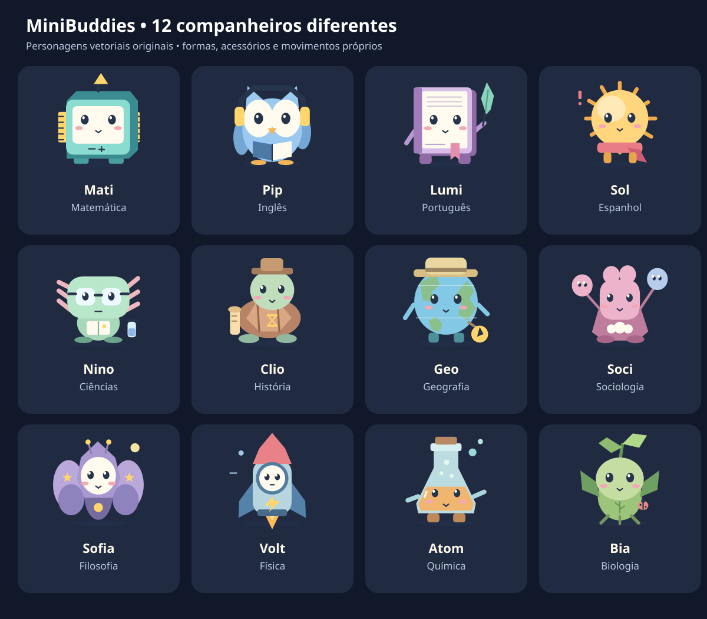

# Doze MiniBuddies diferentes — 0.2.0

| Matéria | Nome | Personagem e acessórios | Movimento característico |
|---|---|---|---|
| Matemática | Mati | Robô de formas geométricas, orelhas de régua e antena triangular | A antena se desloca suavemente |
| Inglês | Pip | Coruja azul com fones e pequeno dicionário | Asas alternam movimentos |
| Português | Lumi | Livro vivo com lombada, marcador e pena | A mão acompanha um pequeno balanço |
| Espanhol | Sol | Sol com raios, cachecol e expressão alegre | Raios pulsam em sequência |
| Ciências | Nino | Axolote com brânquias externas, óculos e frasco | Brânquias ondulam |
| História | Clio | Tartaruga com chapéu, pergaminho e ampulheta no casco | Cabeça se move lentamente |
| Geografia | Geo | Globo com continentes, chapéu de explorador e bússola | Acena com a mão |
| Sociologia | Soci | Companheiro central conectado a dois pequenos amigos | Os amigos oscilam alternadamente |
| Filosofia | Sofia | Mariposa com asas estreladas e uma luz companheira | Asas abrem e fecham; luz flutua |
| Física | Volt | Foguete com aletas, janela e emblema de raio | Chama pulsa |
| Química | Atom | Frasco com rolha, líquido e bolhas | Bolhas sobem dentro e fora do frasco |
| Biologia | Bia | Plantinha com folhas, raízes e joaninha | As folhas superiores balançam |

Todos piscam, mudam a expressão ao receber carinho e recebem acessórios por nível. Ao escolher descanso nos cuidados do pet, os movimentos característicos param e os olhos se fecham. Pausar a captura visual não coloca o bichinho para dormir: ele continua animado sem observar a tela. O ícone da tela de aplicativos corresponde ao personagem de cada matéria.

A identidade visual não altera as perguntas, os dados salvos ou as regras de aprendizagem. A animação usa desenho vetorial local, sem download de imagens ou dependência gráfica adicional. O balão, o arraste e os controles de posição permanecem no mesmo lugar.
